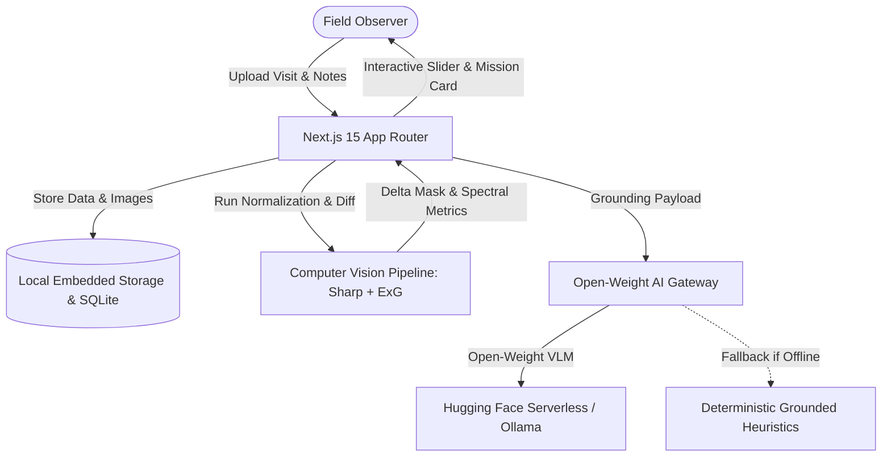

# WildTrace: Grounded Micro-Habitat Observation for the "Touch Grass" Hackathon

*Submission for DEV Community Hacktoberfest Week 1 (October 2026) — Theme: "Touch Grass"*

---

## 🌿 The Problem with AI Nature Apps Today

Most nature-themed AI applications suffer from two fundamental flaws:

1. **The "Single-Shot ID" Trap:** You snap a picture of a leaf, a closed-source commercial API responds *"This is 84% likely an Acer palmatum"*, and you put your phone away. The interaction ends in 5 seconds. You learned a taxonomic label, but you developed zero relationship with the living organism or how it changes.
2. **The "Desktop Chatbot" Trap:** Users sit at their desks asking an LLM trivia questions about nature. Ironically, this encourages people to stay indoors staring at screens instead of actually going outside to **touch grass**.

**Nature is not a static Wikipedia entry. Nature is a continuous, living, longitudinal process.** A patch of moss revives within hours of rainfall. Tree bark fissures shelter dormant mycelial networks that fruit into mushrooms overnight. Soil beds accumulate leaf litter and sprout hidden cotyledons across weeks.

That is why we built **WildTrace**.

---

## 🎯 What is WildTrace?

> **WildTrace is not a plant identifier or an AI nature chatbot. It is a longitudinal micro-habitat observation system that connects repeated real-world visits, visual change detection, evidence-grounded AI interpretation, and actionable follow-up field missions.**

### The Core Loop
1. **Designate a Micro-Habitat:** Select a manageable 30cm to 60cm outdoor quadrant (e.g. tree root hollow, moss rock face, or soil corner).
2. **Record Baseline Observation:** Photograph the quadrant, logging environmental context (soil moisture, lighting, temperature, weather).
3. **Revisit and Detect Visual Shifts:** Return days or weeks later. WildTrace runs algorithmic change detection (Excess Green Index + pixel delta masks) to isolate what physically changed.
4. **Grounded AI Field Intelligence:** An open-weight vision-language model generates plausible hypotheses, discloses camera/lighting confounds, and hands you **one concrete physical mission for your next visit**.

---

## 🏗️ Architecture & Technology Stack

WildTrace was designed to run seamlessly with **zero paid API requirements**, **privacy-first geolocation fuzzing**, and a **100% offline fallback**.



### 1. Grounded Computer Vision (No AI Hallucinations)
Instead of asking an LLM to guess what changed in two pictures, WildTrace computes **algorithmic ground truth** using high-performance Node.js `sharp` and spectral imaging:
- **Excess Green Index (ExG):** Measures `2 * Green - Red - Blue` across grid tiles. This calculates whether vegetative chlorophyll activated, expanded, dried out, or shed leaf matter.
- **Visual Delta Masks:** Highlights pixel change hotspots in vibrant color-coded masks (Lime for vegetation expansion, Magenta for structural displacement, Cyan for moisture darkening).
- **Framing & Illumination Scoring:** Evaluates luminance variance and edge correlation to honestly warn the user when lighting differences or perspective shifts may confound results.

### 2. Open-Weight Vision AI & Scientific Humility
We connect to open-weight models (**SmolVLM-Instruct** and **Qwen2-VL**) validated against strict **Zod schemas**. The system prompt mandates:
- Refuse to make definitive, unsupported species claims.
- Separate observed changes from ecological hypotheses.
- Explicitly disclose camera angles and weather confounds.
- Always provide a tangible **"Touch Grass Field Mission"** encouraging the observer to return.

### 3. Graceful Offline Deterministic Fallback
If you are out in the woods without cell reception, or running the app without API keys, WildTrace does not crash. Its **Grounded Heuristic Engine** converts algorithmic ExG metrics and user notes directly into structured field intelligence.

### 4. Privacy by Design
WildTrace automatically **fuzzes GPS coordinates to ~1.1km resolution** (2 decimal places) before storing them, preventing personal yard triangulation. All image processing stays on the local application server.

---

## 🚀 Running WildTrace Locally in 60 Seconds

WildTrace is built as a single, self-contained Next.js service. No complex Docker networks or external databases are required.

```bash
# 1. Clone the repository
git clone https://github.com/your-username/wildtrace.git
cd wildtrace

# 2. Install dependencies
npm install

# 3. Build & start the application
npm run build
npm start

# Open http://localhost:3000 in your browser!
```

### Running with Docker
```bash
docker compose up --build
```

---

## 🌳 Experience the Demo: "Ancient Oak Root Hollow"

WildTrace comes pre-seeded with a complete two-visit dataset from an actual 80-year-old oak root pocket:
- **Visit 1 (Late Summer):** Dry, desiccated root fissures and dormant gray lichen.
- **Visit 2 (Autumn Post-Rain):** Rehydrated vivid moss cushions and the rapid emergence of two fungal fruiting bodies.

You can slide between both visits with our interactive curtain divider, toggle the difference mask, and inspect the AI field mission prompting your next visit!

---

## 🏆 Why Open-Source & Open-Weight Matters

Field biology and community science cannot depend on expensive, opaque proprietary APIs with fluctuating terms of service. By building WildTrace on open-weight models (Apache 2.0 / Open-Source) and deterministic spectral algorithms, anyone—from community park rangers to students—can observe their local ecology with transparency, reproducibility, and dignity.

**Go outside. Pick a patch of ground. Track it over time. Touch grass.**
